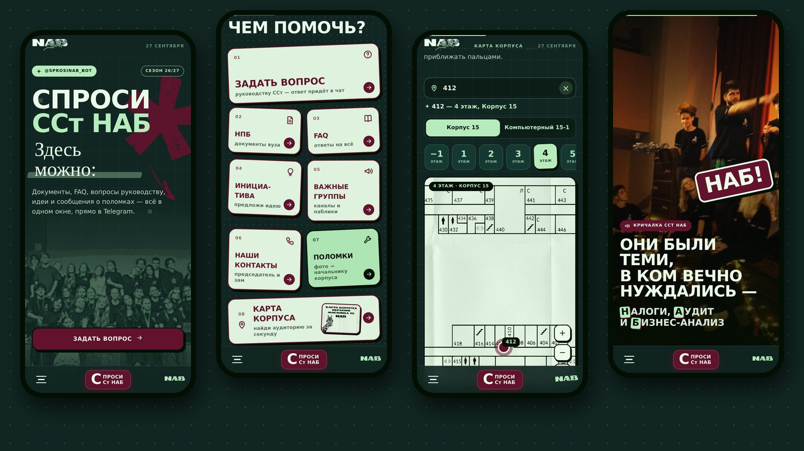
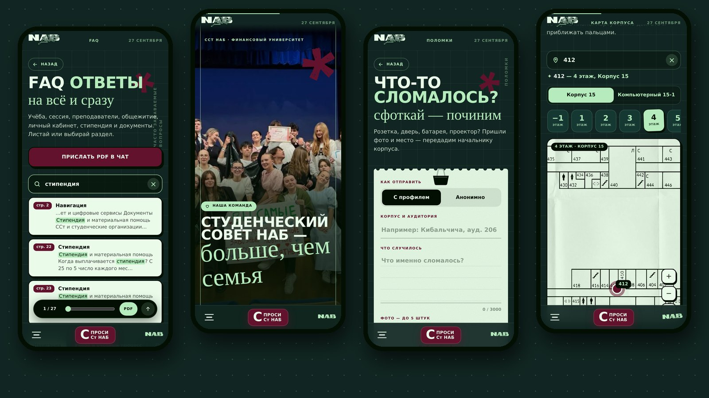

# Спроси ССт НАБ — Telegram Mini App

Веб-приложение внутри Telegram для Студенческого совета факультета «Налоги, аудит и
бизнес-анализ» Финансового университета. Открывается из бота
[@sprosinab_bot](https://t.me/sprosinab_bot).

**Демо в браузере:** https://app.nablabel.ru — отправка обращений работает только внутри Telegram.



Дизайн сделан по брендбуку факультета NAB Label: палитра pine / mint / wine / cream,
шрифты Unbounded и Comfortaa, фактура бумаги, наклейки, «звёздочки» бренда.

## Что внутри

- **Главная как лендинг** — интро с логотипом, бегущие строки, доска-«наклейки» с разделами,
  квест «Шаг 1 из 3» (FAQ → НПБ → каналы), кричалка факультета, фото-галерея, манифест.
- **Формы обращений** — вопрос руководству (можно анонимно), инициатива, поломка с фото
  (до 5 штук, сжатие на телефоне перед отправкой), тревожная кнопка.
- **FAQ-листалка** на 27 страниц: ползунок по страницам, разделы, поиск по тексту, 74 живые
  ссылки прямо поверх страниц — сайты открываются в браузере, каналы в Telegram, почта копируется,
  пункты оглавления переносят на нужную страницу.
- **Карта корпуса** — 9 этажей двух корпусов, двигается и приближается пальцами. Поиск по номеру
  аудитории ставит точку на плане (координаты ~350 аудиторий распознаны с планов).
- **Документы вуза (НПБ)** — листалка и отправка PDF в чат.



## Как устроено

Чистый HTML + CSS + JavaScript — без фреймворков и сборки, три файла и папка `assets/`.

- **Свой стек экранов** вместо `history`: кнопка «назад» Telegram всегда ведёт на предыдущий
  экран, а ссылки вида `#/map` и `startapp=faq` открывают нужный раздел сразу.
- **Анимации только на `transform` / `opacity` / `clip-path`** и `requestAnimationFrame` —
  плавно даже на слабых телефонах. Учитывается `prefers-reduced-motion`.
- **Ленивая загрузка** страниц FAQ через `IntersectionObserver`: картинка грузится, только когда
  страница подъезжает к экрану, пока — мерцающая заглушка с правильными пропорциями.
- **Жесты карты** написаны на Pointer Events: перетаскивание, щипок двумя пальцами, двойной тап.
- **Безопасность** — каждый запрос к API несёт подписанный Telegram `initData`, сервер проверяет
  подпись; вне Telegram формы честно показывают, что отправка доступна только в боте.
- Данные (страницы FAQ, ссылки, текст для поиска, этажи карты) лежат в JSON-манифестах в
  `assets/` — их собирают скрипты из репозитория бота, в коде приложения ничего править не надо.

## Структура

```
index.html            каркас, подключение Telegram WebApp SDK
app.js                экраны, навигация, формы, листалка, карта, анимации
styles.css            дизайн-система и все экраны
assets/brand/         логотипы и фото
assets/faq/           страницы FAQ (webp), links.json, text.json, manifest.json
assets/map/           этажи (webp) и manifest.json с координатами аудиторий
assets/docs/          документы НПБ (собираются на сервере)
```

## Запуск

```bash
python3 -m http.server 8000
# открыть http://localhost:8000
```

Внутри Telegram приложение работает вместе с бэкендом —
[nab-bot](https://github.com/antonshkelll/nab-bot). На сервере этот репозиторий клонируется
в папку `webapp/` бота, статику отдаёт nginx.

## Автор

Антон Шкель, ПрИнж25-1, Финансовый университет при Правительстве РФ.

Код — под лицензией [MIT](LICENSE). Логотипы NAB Label, фотографии и материалы FAQ
принадлежат Студенческому совету НАБ и под лицензию не входят.
